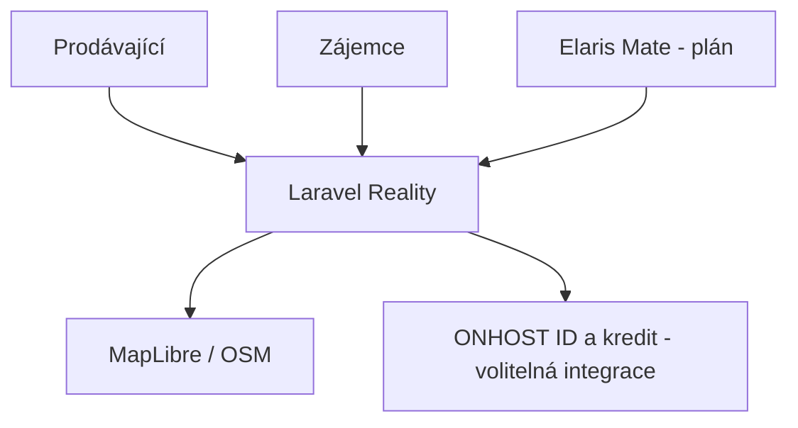

<!-- ONHOST Documentation Standard v5 | Draft for review, NOT merged into GitHub -->
# ONHOST Reality — Czech Property Portal

> **Product documentation · ONHOST V4 · 23 October 2026**  
> **Status:** Existující Laravel MVP, CZ pilot; platby nejsou produkční  
> **Repository:** [Stanektechcz/onhost-realitni-srovnavac](https://github.com/Stanektechcz/onhost-realitni-srovnavac) · **Intended entry:** reality.onhost.cz  
> **Languages:** [Česky](README.md) · [English](README.en.md)

> [!IMPORTANT]
> This README distinguishes **verified repository content** from design proposals and planned interfaces. ONHOST remains in staging. A project may have code without live provider connectivity or production payments.


<!-- ONHOST README V6 EN EXPANSION START -->
## ✨ Product vision V6 — ONHOST Realty

 

> A Czech-pilot real estate portal for owners, agencies and prospective buyers or tenants. The product prioritizes understandable listing flows, real maps, protected contact details and transparent paid promotion.

### Who benefits and what is being built
- Listing wizard, photos, discovery, map and saved searches
- Moderation and privacy of real-estate contacts
- Optional ONHOST ID and wallet integration behind flags

### Architecture and stack
Laravel 13, Blade, Alpine.js, Tailwind 4, Pest.

### Visual identity
Verified CSS: #12001E, #3C096C, #F72585; Inter and League Spartan.

### Delivery status and trust boundary
MVP code is present; paid routes and external integrations are not assumed production ready. Consult the Czech primary README, source code, approved interfaces, and signed owner decisions before treating a design feature as available. No unapproved write action should bypass permission checks, audit logs or independent risk gates.

<!-- ONHOST README V6 EN EXPANSION END -->

## Contents

[About](#about) · [Capabilities](#capabilities) · [Technology](#technology) · [Architecture](#architecture) · [Installation](#installation) · [API](#api) · [Project standards](#standards) · [Development workflow](#workflow) · [Testing](#testing) · [Design](#design) · [Security](#security) · [Roadmap](#roadmap) · [Sources](#sources)

<a id="about"></a>
## About this project

ONHOST Reality is a property listing MVP for the Czech market, helping sellers publish listings and buyers search and contact them safely.

**Product promise:** ONHOST Reality — Czech Property Portal is meant to create a coherent, comprehensible product journey—from an initial user problem to a safe, auditable result. The full user story, decisions and feature matrix are documented in [the primary Czech README](README.md).

ONHOST Reality is a Czech pilot real-estate portal for private sellers, landlords, agencies and prospective buyers or tenants. It is designed around a clear guided listing, strong search, safer contacts and eventual Elaris Mate-assisted publication.

<a id="capabilities"></a>
## Features, value and current status

Listings, media, filters, maps, alerts, moderation, identities and credit-backed commercial options.

### User journeys

### 1. Explore and understand

Users should understand what the product solves, which operations are genuinely supported, and what permissions or prerequisites it needs.

### 2. Act with permission

If the product changes real data, it must validate tenant and resource ownership, request appropriate confirmation, perform the operation through an approved API, then report actual results.

### What exists versus what is planned

Laravel MVP exists. Monetization and real ONHOST credit processing remain behind feature flags and staging controls.


### V5 · Extended product brief

ONHOST Reality is a Czech-market property listing MVP with guided listing creation, media, maps, saved searches, privacy-protected contact and moderation. ONHOST ID and wallet integration exist as optional code paths, not live production payments. A future Elaris Mate workflow will gather required data conversationally, generate a clearly marked draft and request explicit human approval before publication.

**Current-state rule:** Code, a design document, a tested staging service and live commercial availability are separate evidence levels. No planned endpoint must be described as deployed or supported.

#### Audiences and outcomes

- Property owners
- Renters and buyers
- Real-estate agencies

#### Domain modules

- **Listings and media** — Existing or proposed as detailed in the base README.
- **Search, maps and saved alerts** — Existing or proposed as detailed in the base README.
- **Privacy-safe contact** — Existing or proposed as detailed in the base README.
- **Optional ONHOST ID and wallet** — Existing or proposed as detailed in the base README.

#### End-to-end customer experiences

1. A seller enters accurate property attributes, uploads sanitized images, previews a listing and explicitly approves publication.
2. A buyer saves a filtered search and sends a contact request without exposing the seller’s private email address.

#### Commercial model, maturity and roadmap

**Commercial positioning:** See the owner-approved product model and any validated license terms in the main sections. ONHOST Core remains the billing authority; consumer-facing wording must not promise payment integrations or live providers before they are verified.

**Next measurable gates:** Define source-of-truth data and permissions, run relevant test scenarios, validate dependencies on staging, and obtain the owner’s approval before launch.

<a id="technology"></a>
## Technology stack

| Layer | Technology / proposal | Evidence and caveat |
|---|---|---|
| Backend | PHP ^8.3, Laravel ^13, Pest | `composer.json` |
| Frontend | Blade, Alpine.js, Tailwind 4 / Vite | `resources/css/app.css` |
| Data | SQLite test/dev, MariaDB produkční návrh | README |
| Mapy | MapLibre a OSM | Připojení se musí ověřit pro produkci |

Dependencies and runtime choices must be verified from the actual code and lock files. Planned modules must not be described as deployed services. New libraries require security, licensing and long-term maintenance reviews.

<a id="architecture"></a>
## Architecture and project layout



**Important:** The diagram includes proposed relationships. Not every box represents deployed code.

### Repository map

- app/Services/Payments/ — platební adaptéry
- app/Services/Onhost/ — ONHOST ID klient
- routes/web.php — reálné HTTP trasy
- resources/css/app.css — design tokeny
- deploy/aapanel/README.md — nasazení
### Domain concepts

- Listing, seller, listing media a kontaktní požadavky
- SavedSearch, notification
- Moderation report a rozhodnutí
- Ecosystem credit payment reference
<a id="installation"></a>
## Installation and local development

**Project stage:** Existující Laravel MVP, CZ pilot; platby nejsou produkční

- PHP 8.3, Composer, Node; izolovaná SQLite pro test.
- Instalovat závislosti, vygenerovat APP_KEY, vytvořit testovací data.
- Spustit web a testy; ONHOST kredit neaktivovat bez potvrzení finance.

```bash
composer install
npm install
cp .env.example .env
php artisan key:generate
# Pouze lokální vývojová DB:
php artisan migrate --seed
npm run build
php artisan serve
php artisan test
```

> [!WARNING]
> Do not execute database resets, seeders, provisioning or write tests against production. For an empty repository there is no installable application yet.

### Configuration checklist

- ONHOST ID a kredit se řídí `config/onhost.php` a feature flagy.
- Environment potřebuje bezpečně definovanou DB a SMTP konfiguraci; vycházet ze `.env.example`.
- Přesné produkční URL potvrdit vlastním nasazením.

<a id="api"></a>
## API, integrations and data contracts

- Primární současné rozhraní tvoří webové routy.
- Integrační ONHOST ID redirect a callback dle `routes/web.php`.
- Ecosystem credit charge je externí API Core, nikoliv veřejná route Reality.
- Mate asistence s inzerátem je plánovaná, ne veřejný endpoint.

All production contracts require: methods and routes, JSON schemas, auth scopes, resource ownership, expected error status, idempotency (for writes), audit events and contract tests. Draft API descriptions are not callable endpoints.


### V5 · Engineering implementation and delivery playbook

1. **Product contract:** describe user value, real current functionality and a measurable acceptance criterion.
2. **Reuse:** inspect existing ONHOST components, schemas and tests before building a duplicate implementation.
3. **Authority:** define tenant boundaries, API scopes, sensitive data classification and approval requirements.
4. **Implementation:** branch/worktree isolation, versioned events and contracts, no production secrets in Git or logs.
5. **Validation:** unit, integration, authorization, recovery and user-journey checks as applicable.
6. **Review:** check licensing, regressions, cross-product consumers and documentation drift.
7. **Release:** attach reproducible evidence to the commit and verify staging/rollback before owner approval.

#### Product-specific risks and mitigations

- AI must label inferred neighborhood information separately from verified property facts.
- Payment-backed listing access needs idempotent settlement and refunds.

#### Product-owner decisions still open

The following items are **questions**, not confirmed product specifications:

- Confirm final target deployment, launch sequencing and commercial terms with the product owner before publication.

<a id="standards"></a>
## Project standards

### Domain-specific requirements

- Inzerát zveřejnit až po ověření vyžadovaných údajů.
- Údaj o lokalitě doplněný AI jasně oddělit od potvrzených faktů.
- Mazat EXIF a chránit kontakty.
- Platby a nárok na zveřejnění auditovat.

### Common engineering requirements

1. Restrict every operation to the minimum required permissions and tenant scope.
2. Separate real implementation, prototype UI, sample data and future roadmap claims.
3. Use dedicated feature branches, meaningful PR review and reproducible tests.
4. Handle credentials through approved secret storage, never repository files or chat logs.
5. Update API contracts, documentation and test evidence with each meaningful change.
6. Never bypass financial, security or production approval through an AI tool.

<a id="workflow"></a>
## Development and operational workflow

**Feature delivery:** product intent → architecture/source review → issue and acceptance criteria → implementation and tests → code/security review → staging validation → release notes.

**Domain workflows**

- Nový inzerát: údaje → validace → fotky → náhled → schválení → publikace.
- Mate flow: záměr → doplnění povinných údajů → návrh textu → lidská kontrola → autorizovaná publikace.
- Moderace: report → vyhodnocení → odůvodnění → případná revize.

**Incidents:** preserve evidence, determine blast radius, avoid blind retries, use approved recovery processes, and add regression tests.

<a id="testing"></a>
## Testing and release acceptance

Every production candidate needs unit/integration tests, authorization tests, security checks, a reproducible build, an environment-specific smoke test, rollback procedures and a responsible approver. Technical confidence is grounded in actual CI and staging evidence, not the existence of a testing command.

### Success criteria

- Čas vytvoření úplného inzerátu bez chyb.
- Doručení požadavku správnému vlastníkovi.
- 0 neautorizovaných čtení soukromých kontaktů.

<a id="design"></a>
## Design system and accessibility

Potvrzená paleta CSS: ink `#12001E`, plum `#3C096C`, light `#F5EEFB`, akcent `#F72585`; Inter a League Spartan.

Each ONHOST product may use its own visual identity within ONHOST V2. Semantic tokens, keyboard support, sufficient contrast, localization and accessible alternatives are required. Colors named in a proposal are not approved implementation values.

<a id="security"></a>
## Security and responsibility

- Nevytvářet nepodložená tvrzení o cenách lokalit ani stavu nemovitosti.
- Český trh je první pilot, evropskou expanzi zatím neslibovat.

Protect personal data, enforce least privilege, validate webhooks, retain auditable decision trails and obtain specialist reviews for healthcare, finance and minors. An LLM recommendation is not sufficient authority for an irreversible action.

<a id="roadmap"></a>
## Product roadmap

- **P0:** dokončit CZ pilot, testy fotek, audit moderace a kontaktních přístupů.
- **P1:** certifikovat ONHOST ID a kreditní integraci.
- **P2:** AI Mate konverzační tvorba inzerátů.

See the [primary Czech README](README.md) for the fuller product strategy and its current verification status.

<a id="sources"></a>
## Sources, governance and contributions

- [README.md](https://github.com/Stanektechcz/onhost-realitni-srovnavac/blob/HEAD/README.md)
- [resources/css/app.css](https://github.com/Stanektechcz/onhost-realitni-srovnavac/blob/HEAD/resources/css/app.css)
- [routes/web.php](https://github.com/Stanektechcz/onhost-realitni-srovnavac/blob/HEAD/routes/web.php)
- [config/onhost.php](https://github.com/Stanektechcz/onhost-realitni-srovnavac/blob/HEAD/config/onhost.php)

Product documentation owner: **Adrian Staněk**, STANEKTECH / ONHOST. Third-party source licenses and all contributor IP rights must be verified before any open-source publication. This documentation pack is a **review draft**, not a GitHub merge or production deployment.

[Previous README](docs/README_BEFORE_V5.md) · [Czech product README](README.md)


<!-- ONHOST V7 PRODUCT BLUEPRINT EN -->
## 🧭 V7 · Product vision, scope and delivery details

**Product thesis:** ONHOST Reality — jednoduše od záměru k důvěryhodnému inzerátu. The Czech README contains the full narrative and role scenarios. This English companion identifies the verifiable source files, core module boundaries, the target data model and safety considerations.

### Product capability map
- Nabídky k prodeji a pronájmu, fotografie, parametry a deduplikace
- MapLibre/OSM, vyhledávání, alerty a SEO
- Moderace a audit dle odpovědnosti platformy
- ONHOST ID a kredity zatím za feature flagy
- AI popisky výslovně odlišit od ověřených údajů o lokalitě

### Data model extensions — partly proposed
- Listing / Property / AddressArea
- MediaAsset / MediaVariant / ExifRemoval
- SellerIdentity / Agency / ContactInquiry
- SavedSearch / AlertSubscription / ModerationCase

### APIs and integration evidence
- Existující ONHOST integrační klienty ověřit v `config/onhost.php`
- Feature-flagované OIDC a `POST /v1/wallet/ecosystem/charges` na Core
- Návrh Mate: `createDraft`, `validate`, `preview`, `publish` jako samostatná schvalovaná capability

### Measurement and launch readiness
- Čas vytvoření validního inzerátu
- Podíl dokončených návrhů a počet chyb povinných polí
- Míra duplikací, podvodů a zneužití kontaktů
- Úspěšnost alertů a UX mapy na mobilu

**Source of truth:** `routes/web.php`, `config/onhost.php`, `resources/css/app.css`, `app/Services/Payments/`.

> [!NOTE]
> Product capability in the repository does not imply a live production launch. All new integration contracts require approval and staging tests.
<!-- /ONHOST V7 PRODUCT BLUEPRINT EN -->
