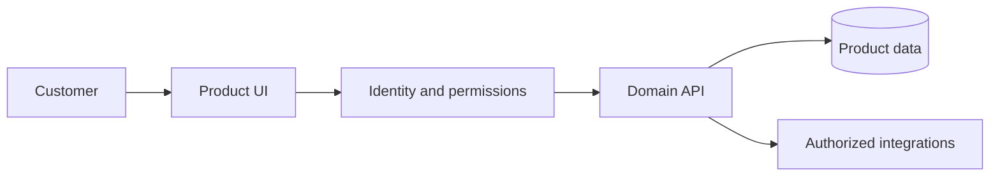

# ONHOST Reality — English Overview

<!-- ONHOST DEV HUB V1 -->
> [!TIP]
> Developer hub: [docs/onhost](docs/onhost/README.md) · [Contributing](CONTRIBUTING.md) · [Security](SECURITY.md) · [Elaris skills](.agents/skills/onhost-context/SKILL.md)
<!-- END ONHOST DEV HUB -->

> **Z nemovitosti k důvěryhodnému inzerátu rychle, přehledně a s asistencí AI.**

**Status:** Laravel MVP; ONHOST ID a kreditní integrace za feature flagy  
**Domain:** reality.onhost.cz; pilot ČR  
**Docs:** [Full Czech README](README.md) · [Archived complete V7](docs/archive/README_V7_CZ_EN.md)

## Why this product exists

Reality mají odstranit překážky při zveřejnění nabídky. Soukromý vlastník či agentura vloží srozumitelný strukturovaný inzerát, fotografie a údaje o lokalitě; zájemce může filtrovat, uložit hledání a bezpečně kontaktovat inzerenta. Elaris Mate později připraví draft inzerátu z jediné konverzace, ale publikace vždy vyžaduje potvrzení vlastníka.

## Who benefits

- Soukromý inzerent: jednoduché vložení, návrh textu, přehled reakcí
- Realitní kancelář: portfolio, týmové role a správa nabídek
- Zájemce: mapy, upozornění a přesné filtry
- Moderátor: ochrana proti podvodům, duplicity a zneužití kontaktů

## Functional areas and evidence

|Area|What it does|Maturity|
|:--|:--|:--|
|Inzerce|Strukturované nabídky, fotografie, náhled|MVP kód|
|Vyhledávání a mapa|Filtry, uložené hledání, MapLibre/OSM|Kód|
|ONHOST ID|Volitelné account linking|Feature flag|
|Platby kreditem|Ekosystémové charges/reversal|Feature flag|
|Elaris draft creator|Conversational návrh inzerátu|Plán|

## Customer experience

1. Uživatel vyplní údaje → foto pipeline odstraní EXIF → náhled → moderace → publikace.
2. Zájemce filtruje bydlení → zapne mapu → uloží hledání → dostane změnové upozornění.
3. Mate sestaví popis a parametry → inzerent doplní chybějící údaje → schválí výsledný draft.

## Architecture



## Technology and getting started

- PHP 8.3 / Laravel 13, Blade, Alpine.js, Tailwind 4
- Pest a Vite; SQLite v dev/test, MariaDB podle provozních podkladů
- MapLibre/OSM, image transformation

```bash
composer install && npm install
cp .env.example .env
php artisan key:generate
php artisan test
npm run build
```

## Data, API and configuration

- Property, Listing, MediaAsset, Seller
- Inquiry, SavedSearch, AlertSubscription
- ModerationCase, OnhostAccountLink, CreditCharge
- Skutečné routy podle routes/web.php a config/onhost.php.
- Integrace ONHOST Core používá feature-flagované účtování /v1/wallet/ecosystem/charges.
- Mate budoucí createDraft/preview/publish musí autorizovat zvlášť.
- ONHOST_ID a ONHOST_CREDIT nevydávat za spuštěné služby.
- Media EXIF removal, evidence zdroje lokalitních dat.
- Údaje vlastníka a kontakty jsou citlivé i v AI požadavcích.

## Visual identity

- Ink #12001E
- Plum #3C096C
- Accent #F72585
- Light #F5EEFB

## Risks, milestones and quality

- AI popis nemovitosti není automaticky pravdivý.
- Před ostrými platbami jsou nutné reconciliace a právní podmínky.

1. Spolehlivý český MVP katalog a moderace
2. Validace ONHOST ID a kreditní smlouvy na stagingu
3. Mate workflow vytváření a úpravy inzerátu
4. Agenturní funkce a export portfolií

**Definition of done:** verified customer journey, negative permission tests, current API contracts, accessible UI, documented rollback and explicit owner approval. Product plans are not claims of production availability.

**Owner:** Adrian Staněk.
