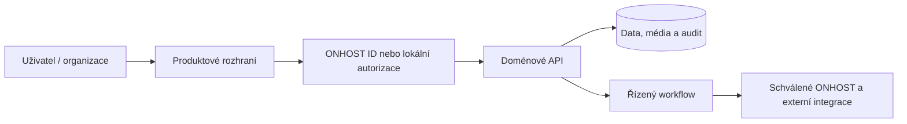

# ONHOST Reality

> **Z nemovitosti k důvěryhodnému inzerátu rychle, přehledně a s asistencí AI.**

**Stav:** Laravel MVP; ONHOST ID a kreditní integrace za feature flagy  
**Produktová doména:** reality.onhost.cz; pilot ČR  
**Dokumentace:** [CZ](README.md) · [EN](README.en.md) · [Archiv kompletní V7](docs/archive/README_V7_CZ_EN.md)

> [!IMPORTANT]
> **Ověřený stav ≠ plán.** Funkce přítomná v kódu nemusí být dostupná v produkci; připravované API, placení a rozšíření mohou být jen specifikací. Plný technický obsah V7 je zachován v archivu.

## Navigace

[O projektu](#o-projektu) · [Pro koho](#cíloví-uživatelé) · [Funkce](#produktové-moduly) · [Scénáře](#konkrétní-scénáře) · [Technologie](#stack-a-architektura) · [Instalace](#instalace) · [API](#api-a-datové-modely) · [Design](#brand-a-přístupnost) · [Roadmapa](#roadmapa)

## O projektu

Reality mají odstranit překážky při zveřejnění nabídky. Soukromý vlastník či agentura vloží srozumitelný strukturovaný inzerát, fotografie a údaje o lokalitě; zájemce může filtrovat, uložit hledání a bezpečně kontaktovat inzerenta. Elaris Mate později připraví draft inzerátu z jediné konverzace, ale publikace vždy vyžaduje potvrzení vlastníka.

### Očekávaný přínos

Výsledkem má být nejen množství funkcí, ale především srozumitelné zákaznické workflow, dohledatelná odpovědnost za data, přístupná administrace a bezpečný provoz s jasným mechanismem návratu při chybě.

## Cíloví uživatelé

- Soukromý inzerent: jednoduché vložení, návrh textu, přehled reakcí
- Realitní kancelář: portfolio, týmové role a správa nabídek
- Zájemce: mapy, upozornění a přesné filtry
- Moderátor: ochrana proti podvodům, duplicity a zneužití kontaktů

## Produktové moduly

|Oblast|Popis a uživatelská hodnota|Stav podkladů|
|:--|:--|:--|
|Inzerce|Strukturované nabídky, fotografie, náhled|MVP kód|
|Vyhledávání a mapa|Filtry, uložené hledání, MapLibre/OSM|Kód|
|ONHOST ID|Volitelné account linking|Feature flag|
|Platby kreditem|Ekosystémové charges/reversal|Feature flag|
|Elaris draft creator|Conversational návrh inzerátu|Plán|

## Konkrétní scénáře

1. Uživatel vyplní údaje → foto pipeline odstraní EXIF → náhled → moderace → publikace.

2. Zájemce filtruje bydlení → zapne mapu → uloží hledání → dostane změnové upozornění.

3. Mate sestaví popis a parametry → inzerent doplní chybějící údaje → schválí výsledný draft.

## Stack a architektura

- PHP 8.3 / Laravel 13, Blade, Alpine.js, Tailwind 4
- Pest a Vite; SQLite v dev/test, MariaDB podle provozních podkladů
- MapLibre/OSM, image transformation



## Instalace

```bash
composer install && npm install
cp .env.example .env
php artisan key:generate
php artisan test
npm run build
```

> [!CAUTION]
> Používat výhradně izolované vývojové prostředí. Nikdy nemigrovat reálnou DB bez explicitního souhlasu a ověřené zálohy.

## API a datové modely

**Doménové entity:**
- Property, Listing, MediaAsset, Seller
- Inquiry, SavedSearch, AlertSubscription
- ModerationCase, OnhostAccountLink, CreditCharge

**Kontrakty a integrační hranice:**
- Skutečné routy podle routes/web.php a config/onhost.php.
- Integrace ONHOST Core používá feature-flagované účtování /v1/wallet/ecosystem/charges.
- Mate budoucí createDraft/preview/publish musí autorizovat zvlášť.

Každou novou mutaci dokumentovat uvedením metody, schématu, oprávnění, idempotence a rollbacku. Elaris Mate musí respektovat stejná oprávnění jako grafické UI.

## Konfigurace

- ONHOST_ID a ONHOST_CREDIT nevydávat za spuštěné služby.
- Media EXIF removal, evidence zdroje lokalitních dat.
- Údaje vlastníka a kontakty jsou citlivé i v AI požadavcích.

## Bezpečnost a standardy

- AI popis nemovitosti není automaticky pravdivý.
- Před ostrými platbami jsou nutné reconciliace a právní podmínky.

- Každý nový modul má unit a integrační testy; negativní tenant scénáře jsou povinné.
- Nezapisovat tajemství ani osobní údaje do Git historie či běžných debug logů.
- Všechny externí integrace vyžadují podepsané/ověřené zprávy, monitoring a bezpečný retry.
- Změny zahrnují dokumentaci, API schema, UX kontrolu a plán obnovy.

## Brand a přístupnost

- Ink #12001E
- Plum #3C096C
- Accent #F72585
- Light #F5EEFB

Produkt může mít vlastní identitu; kontrast, mobilní přehlednost, klávesnice, vysvětlitelné stavové hlášky a srozumitelné procesy jsou povinné.

## Roadmapa

1. **Fáze 1:** Spolehlivý český MVP katalog a moderace
2. **Fáze 2:** Validace ONHOST ID a kreditní smlouvy na stagingu
3. **Fáze 3:** Mate workflow vytváření a úpravy inzerátu
4. **Fáze 4:** Agenturní funkce a export portfolií

## Akceptační kritéria

- [ ] Funkce doložena skutečnou implementací a reprodukovatelným testem.
- [ ] Přístupové role a hranice tenantů ověřené negativními testy.
- [ ] API, UX, konfigurace a dokumentace odpovídají vydání.
- [ ] Monitoring, obnova a rollback jsou vysvětlené operátorovi.
- [ ] Vlastník přezkoumal brand, produktová tvrzení a licencování.

## Zdroje

- routes/web.php
- config/onhost.php
- resources/css/app.css
- deploy/aapanel/README.md

[Archiv plného README V7, včetně anglické dokumentace](docs/archive/README_V7_CZ_EN.md) · **Vlastník:** Adrian Staněk.
