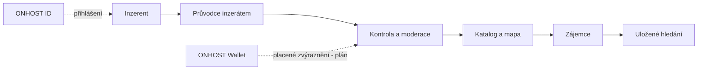
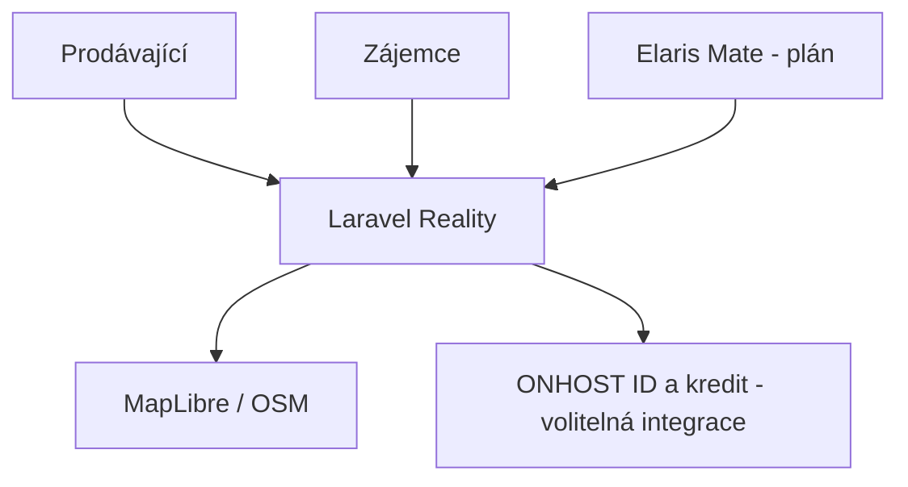

<!-- ONHOST Documentation Standard v5 | Product + Engineering Extended | Draft for review, NOT merged into GitHub -->
# ONHOST Reality — jednodušší cesta od inzerátu k bydlení

> **Rychlé vložení a hledání nemovitosti bez zbytečných formulářů — později i jedinou konverzací s Elaris Mate.**
>
> **Stav:** Existující Laravel MVP, CZ pilot; platby nejsou produkční  
> **Repozitář:** [Stanektechcz/onhost-realitni-srovnavac](https://github.com/Stanektechcz/onhost-realitni-srovnavac) · **Produkt:** reality.onhost.cz  
> **Dokumentace:** [Česky](README.md) · [English](README.en.md)  
> **Vlastník dokumentace:** Adrian Staněk · ONHOST / STANEKTECH · **Značka:** ONHOST V2 + vlastní identita produktu

> [!IMPORTANT]
> **Ověření versus vize.** Názvy funkcí, modelové scénáře a plánované API v tomto README nejsou prohlášením o produkčním nasazení. ONHOST jako celek je ve stagingu; Comgate a skutečné kreditní platby nejsou produkčně spuštěné. U prázdného repozitáře jde o návrh produktu.

**Rychlá navigace**

> **Novinka V5:** Rozšířený produktový kompas, přesná mapa modulů, end-to-end zákaznické scénáře, bezpečnostní scénáře a konkrétní vývojový playbook jsou vloženy přímo do příslušných sekcí.

| | | |
|---|---|---|
| [01 · O projektu](#o-projektu) | [02 · Pro koho je projekt určen](#uzivatele) | [03 · Co projekt nabízí](#funkce) |
| [04 · Zkušenost uživatele a scénáře](#scenare) | [05 · Aktuální stav projektu](#stav) | [06 · Stack projektu](#stack) |
| [07 · Architektura projektu](#architektura) | [08 · Instalace projektu](#instalace) | [09 · Konfigurace projektu](#konfigurace) |
| [10 · API a datové kontrakty](#api) | [11 · Standardy projektu](#standardy) | [12 · Vývojové a provozní postupy](#postupy) |
| [13 · Testování a kvalita](#testovani) | [14 · Design systém a značka](#design) | [15 · Bezpečnost a práva](#bezpecnost) |
| [16 · Integrace v ekosystému](#integrace) | [17 · Roadmapa projektu](#roadmapa) | [18 · Otázky a odpovědi](#faq) |
| [19 · Dokumentace a správa](#zdroje) | | |

<a id="o-projektu"></a>

<!-- ONHOST README V6 PRODUCT EXPANSION START -->
## ✨ ONHOST Reality: detailní produktová vize (V6)

 

> ### Realitní portál bez složité inzerce, se skutečně použitelným vyhledáváním.
>
> Cílem je umožnit běžnému majiteli bytu, realitní kanceláři i zájemci o nemovitost snadno nabídnout, ověřit a objevit relevantní nabídku. Portál má propojit kvalitní prezentaci lokalit, pohodlnou práci s médii, transparentní zvýraznění nabídek a platby ONHOST — bez skryté manipulace s hodnocením či daty.

### 👥 Pro koho systém vzniká
- Soukromý inzerent — průvodce přidáním prodeje nebo pronájmu
- Realitní kancelář — opakovaná správa portfolia a kontaktů
- Zájemce — filtry, mapa, uložené hledání a upozornění
- Moderátor — kontrola závadných nabídek a spamových účtů

### 📦 Co nabídne / nabízí
- Laravel 13 MVP: vkládání inzerátů, média, filtry a mapa
- Uložená hledání, upozornění, SEO a kontaktní workflow
- ONHOST ID a platby kreditem jako volitelné integrace za feature flagy
- Bezpečné zpracování fotografií, optimalizace a odstranění citlivých EXIF
- Budoucí asistované texty, čtvrťové informace pouze se zdrojovanými údaji

### 🔁 Jak vypadá skutečná cesta uživatele
1. Inzerent se přihlásí nebo si založí účet.
2. Průvodce shromáždí typ nabídky, dispozici, lokalitu, cenu, vybavení a fotografie.
3. Systém zobrazí kontrolní náhled, povinné informace a cenu případného zvýraznění.
4. Po schválení moderace je nabídka zveřejněna.
5. Zájemce si uloží hledání, kontaktuje inzerenta a může nabídku nahlásit.

### 🧱 Stack, data a rozhraní
**Stack a jeho stav:** Laravel 13, PHP 8.3, Blade, Alpine.js, Tailwind 4, Pest, MapLibre/OSM; SQLite dev/test, MariaDB podle dokumentace.

**Základní entity:** Listing → Media → Location → Owner; User → SavedSearch → Alert; Listing → ModerationReport.

**API, včetně rozlišení implementace a návrhu:**
- `/onhost/propojit` a `/onhost/callback` — existující OIDC integrační cesty
- `POST /v1/wallet/ecosystem/charges` — volání ONHOST Core, není lokální endpoint Reality
- Budoucí API: `GET /api/v1/listings`, `POST /api/v1/listings`, `POST /api/v1/reports` — návrh, nikoli hotový router

**Konfigurace a pravidla:**
- ONHOST ID a kredity povolovat pouze po ověření testů a schválení
- API klíče pro externí mapy nebo geokódování chránit mimo Git
- Pilotní trh ČR, na rozšíření států připravit lokalizovatelné adresní modely

### 🕸️ Schéma fungování


### 🎨 Grafická identita a design
🏡 Realitní brand — `#12001E` text, `#3C096C` fialová, `#F72585` CTA, `#F5EEFB` světle fialové plochy. Tyto hodnoty jsou potvrzené v `resources/css/app.css`.

Použít sémantické tokeny, rozumné hustoty informací, přístupné formuláře a alternativu ke všem interaktivním prvkům. Definitivní podoba se schvaluje podle brandmanuálu produktu; existující CSS má přednost před novým návrhem.

### ⚠️ Co v žádném případě neslibujeme bez ověření
- Žádné smyšlené detaily o lokalitě, dopravě nebo cenách nemovitostí
- Práva k fotografiím, ochrana osobních kontaktů a pravidla moderace DSA
- Placené služby držet vypnuté do ověření ONHOST kreditu a Comgate
- V pilotu komunikovat pouze dostupnost pro ČR.

### 📍 Postup vývoje
**MVP → integrace → zabezpečení → reprodukovatelné testy → staging → owner sign-off → produkce.**

Každý splněný milník musí mít konkrétní implementaci, testy, věrohodné provozní důkazy a odpovědnou osobu.

<!-- ONHOST README V6 PRODUCT EXPANSION END -->

## 01 · O projektu

**Jednou větou:** Rychlé vložení a hledání nemovitosti bez zbytečných formulářů — později i jedinou konverzací s Elaris Mate.

**Problém, který řešíme:** Inzerenti opakují údaje a zájemci obtížně filtrují nabídky; ONHOST Reality chce jednoduchý přehled a bezpečnou komunikaci.

ONHOST Reality má nabídnout běžnému člověku i profesionálnímu inzerentovi přehledný způsob publikace a hledání nemovitostí. Nechceme, aby uživatelé zápasili s desítkami kroků, opakovaným přepisováním údajů a nepřehledným kontaktem mezi stranami. **Inzerát má vzniknout průvodcem nebo v budoucnu rozhovorem s Elaris Mate** — uživatel uvede základní fakta, AI může navrhnout srozumitelný popis, ale vlastník schvaluje správnost i zveřejnění.

Pro zájemce je klíčové snadné filtrování, mapová orientace, uložené vyhledávání, kvalitní fotografie a bezpečné kontaktování. Pro provozovatele pak ověřené role, DSA moderace, platby a transparentní podmínky. Pilot se soustředí **pouze na český trh**.

Repozitář obsahuje existující Laravel MVP, ale placené funkce používají feature flagy a produkční napojení na ONHOST kredity není spuštěné.

### Dlouhodobá produktová vize

Projekt má být samostatně pochopitelný, udržovatelný a komerčně či komunitně použitelný produkt v rámci ONHOST. Vývoj nemá končit sestavením obrazovek: musí pokrýt celý tok uživatele, jeho oprávnění, správu dat, rozhraní, provoz, kvalitní podporu, obnovu a dlouhodobou aktualizaci. Specifické cíle jsou popsány v dalších sekcích; každý neověřený prvek zůstává označen jako návrh.

<a id="uzivatele"></a>
## 02 · Pro koho je projekt určen

- Soukromí inzerenti, kteří prodávají či pronajímají.
- Realitní kanceláře a správci portfolia.
- Zájemci o bydlení a investice.

### Hlavní role a jejich očekávání

- Soukromý prodávající/pronajímatel: průvodce a ověřené kontakty.
- Zájemce: filtry, mapa, uložené hledání.
- Realitní profesionál: více nabídek a oprávnění.
- Moderátor: hlášení a audit.

**Princip UX:** nového člověka musí README naučit, proč produkt potřebuje, a vývojáři současně vysvětlit, které operace jsou technicky citlivé. Uživatel neřeší interní názvy modulů: řeší výslednou službu.

<a id="funkce"></a>
## 03 · Co projekt nabízí

| Služba / oblast | Co znamená pro uživatele | Stav podkladů |
|---|---|---|
| **Průvodce nabídkou** | Typ, cena, dispozice, energetická náročnost, fotografie, popis a lokalita. | Kód MVP |
| **Vyhledávání a mapa** | Filtry, řazení, uložené nabídky a MapLibre/OSM. | Kód MVP |
| **Hlídací pes** | Uložená vyhledávání a relevantní upozornění. | Kód MVP |
| **Zabezpečené kontakty** | Maskované e-maily, moderace a audit. | Kód MVP |
| **Elaris Mate nabídka** | Asistované vytvoření popisu, doplňování povinných dat a publikace až po potvrzení. | Plán |

> **Jak číst stav:** „Katalog a kód“ = existuje odpovídající implementace nebo definice produktu v repozitáři, **ne** ověřené komerční poskytování služby. „Plán“ = produktová vize bez potvrzené implementace. Technické a cenové sliby se řídí aktuálním schváleným kontraktem, nikoli demo obsahem.

### Klíčové produktové celky

- Vkládání a úpravy nabídek přes průvodce
- Filtry, MapLibre/OSM mapy a uložené hledání
- Notifikace a hlídač relevantních inzerátů
- Bezpečné kontaktování a moderace
- ONHOST ID/kredit za feature flagem; budoucí Mate import

> [!NOTE]
> **Stavové popisky:** *Kód/MVP* znamená zdrojové soubory či testovatelný modul, nikoli dokončené nasazení. *Prototyp* je demonstrace. *Plán* není dodanou funkcionalitou. U každé vydávané služby musí být tento status potvrzen reálným testem.


### V5 · Produktový kompas — co vlastně vytváříme

Český realitní pilot, který spojuje intuitivní zveřejnění nabídky, kvalitní vyhledávání a důvěryhodnou komunikaci. V budoucnu Elaris Mate dovede zákazníka jediným chatem od nápadu inzerátu k dokončenému a zkontrolovanému návrhu.

**Výsledná hodnota:** produkt musí umět vysvětlit zákazníkovi, jakou jeho potřebu naplní, co se stane s jeho daty, kdo nese odpovědnost za výsledek a jak se dostane od prvního kroku ke skutečně dokončenému úkolu.

#### Uživatelé a jejich konkrétní očekávání

| Kdo | Očekávání |
|---|---|
| Pronajímatel nebo prodávající |  vloží přesný inzerát. |
| Zájemce |  najde nabídky podle filtrů a lokality. |
| Realitní agentura |  spravuje portfolio a oprávnění. |


#### Přehled produktových a technických modulů

| Modul | Přínos | Kde je zdroj | Stav |
|---|---|---|---|
| Listings | CRUD inzerátů a média | `app/` | MVP kód |
| Search & maps | Filtry a MapLibre OSM | README | MVP kód |
| ONHOST wallet | Poplatky a nároky | `app/Services/Payments/` | Vypnuto na stagingu |
| Mate guided create | Chat průvodce | Budoucí adapter | Plán |


**Interpretace stavu:** „Existuje v kódu“ znamená nalezený modul/soubor, nikoliv ověřené produkční poskytování. „Návrh“ znamená plán. Živá data providerů, aktuální kapacitu, ceny a oprávnění je třeba ověřit samostatně. U prázdného repozitáře neexistuje API ani funkční instalátor.

#### Uživatelské cesty od požadavku k výsledku

#### 1. Založení inzerátu

**Průběh:** Průvodce shromáždí typ nabídky, adresu, stav, rozměry, cenu, fotky a kontaktní preference, vytvoří náhled a vyžádá publikaci.

**Selhání a ochrana:** Vlastník musí schválit veřejné informace; AI nevymýšlí parametry ani právní stav.

#### 2. Zájem o nemovitost

**Průběh:** Zájemce uloží filtr, dostane upozornění na odpovídající nabídky a pošle kontakt přes portál.

**Selhání a ochrana:** Neodhalit email prodávajícího a respektovat odvolání komunikace.

#### Datový model — co musí zůstat konzistentní

- Listing, Price, Location, Media, ContactRequest.
- PublicationReview propojuje zadavatele a rozhodnutí.
- EcosystemPaymentRef bez uložení jiného ledgeru.


#### Obchodní a provozní model

Pilotní české inzeráty s případným členstvím, zvýrazněním a transakčním modelem teprve po schválení cen a zapnutí plateb. Nelze tvrdit, že jsou placené funkce produkčně dostupné.

### V5 · Úspěch projektu znamená ověřitelný výsledek

Nejde o počet obrazovek ani implementovaných tříd. Úspěch musí být doložen přístupovými testy, zátěžovým profilem odpovídajícím cílovému provozu, reprodukovatelným E2E scénářem a kontrolovanou obnovou po chybě. Klient musí vždy rozeznat **návrh AI**, **čekající operaci**, **skutečně potvrzený výsledek** a **výpadek nebo odmítnutí**.

<a id="scenare"></a>
## 04 · Zkušenost uživatele a scénáře

### 1. Jednoduchý inzerát

Vytvořit nabídku → nahrát fotky → doplnit fakta → zobrazit náhled a podmínky → potvrdit publikaci.

### 2. Hledání bytu

Nastavit lokalitu a rozpočet → filtrovat → uložit hledání → kontaktovat inzerenta.

### Doménové postupy, které musí podporovat architektura

- Nový inzerát: údaje → validace → fotky → náhled → schválení → publikace.
- Mate flow: záměr → doplnění povinných údajů → návrh textu → lidská kontrola → autorizovaná publikace.
- Moderace: report → vyhodnocení → odůvodnění → případná revize.

### Jak budeme hodnotit použitelnost

- Čas vytvoření úplného inzerátu bez chyb.
- Doručení požadavku správnému vlastníkovi.
- 0 neautorizovaných čtení soukromých kontaktů.

<a id="stav"></a>
## 05 · Aktuální stav projektu

**Pravdivý aktuální stav:** Existující Laravel MVP, CZ pilot; platby nejsou produkční.

### Co už máme jako technický základ

- Laravel 13 MVP, integrace platebních providerů a ONHOST ID/credit návrhů.

### Čím se chceme odlišovat

- Český pilot s jednoduchým, právně čitelným procesem zveřejnění.
- Budoucí propojení s konverzační vrstvou Mate.

### Co je nutné ještě dokončit nebo ověřit

- Ověřit produkční napojení na ONHOST Core, komerční podmínky a publishing workflow.

### Co dokumentace neslibuje

- AI informace o lokalitě je nutno citovat a ověřovat, nesmí si vymýšlet údaje o nemovitosti.

<a id="stack"></a>
## 06 · Stack projektu

Technologické názvy jsou rozděleny podle **zdroje pravdy**. Pokud není v repozitáři implementace, uvádíme cílový stack výslovně jako návrh.

| Vrstva | Technologie / koncept | Stav a ověření |
|---|---|---|
| Backend | PHP ^8.3, Laravel ^13, Pest | `composer.json` |
| Frontend | Blade, Alpine.js, Tailwind 4 / Vite | `resources/css/app.css` |
| Data | SQLite test/dev, MariaDB produkční návrh | README |
| Mapy | MapLibre a OSM | Připojení se musí ověřit pro produkci |

### Pravidla pro volbu technologií

- Nejprve prověřit stávající knihovny, testy a integrační kontrakty. Nesplývat „závislost v manifestu“ s „používáno v produkci“.
- Nové závislosti přidávat s odůvodněním přínosu, licenční kompatibility, update politiky a bezpečnostní podpory.
- Správně oddělit aplikaci, doménu, infrastrukturu a prezentaci. U open-source projektů umožnit skutečně samostatný provoz.
- Zajistit reprodukovatelný build přes lock soubory a verzovanou CI; bez něj nejde o hotový release.

<a id="architektura"></a>
## 07 · Architektura projektu

### Systémový přehled



> Diagram ukazuje **logické souvislosti**; blok označený jako plán není potvrzenou implementací. Architekturu vždy ověřit proti aktuálním routám, třídám a datovým smlouvám.

### Mapa repozitáře

- `app/Services/Payments/` — platební adaptéry
- `app/Services/Onhost/` — ONHOST ID klient
- `routes/web.php` — reálné HTTP trasy
- `resources/css/app.css` — design tokeny
- `deploy/aapanel/README.md` — nasazení

### Základní datové entity a doménové hranice

- Listing, seller, listing media a kontaktní požadavky
- SavedSearch, notification
- Moderation report a rozhodnutí
- Ecosystem credit payment reference

**Hranice:** soukromá data, tajemství a produkční změny nepatří do sdíleného LLM kontextu. Cross-product integrace musí využít explicitní API a oprávnění, nikoli přímé dotazy na databázi jiného produktu.

<a id="instalace"></a>
## 08 · Instalace projektu

### Předpoklady a kontrolní body

- PHP 8.3, Composer, Node; izolovaná SQLite pro test.
- Instalovat závislosti, vygenerovat APP_KEY, vytvořit testovací data.
- Spustit web a testy; ONHOST kredit neaktivovat bez potvrzení finance.

### Příkazy pro existující vývojové prostředí

```bash
composer install
npm install
cp .env.example .env
php artisan key:generate
# Pouze lokální vývojová DB:
php artisan migrate --seed
npm run build
php artisan serve
php artisan test
```

> [!WARNING]
> Příkazy jsou relevantní pouze tehdy, když odpovídají skutečné verzi repozitáře a prostředí. **Nikdy neprovádět `migrate:fresh`, seedery ani testovací provisionování na produkci nebo na reálných zákaznických datech.** U konceptů se záměrně neuvádějí fiktivní instalační příkazy.

### Po spuštění zkontrolovat

1. Běží runtime ve správné verzi a čte pouze vývojové konfigurace.
2. Aplikace přistupuje ke správné izolované databázi.
3. Testovací účet má omezená oprávnění a všechna citlivá prostředí jsou oddělena.
4. Po změně kódu lze opakovat testy, sestavit artefakt a dohledat commit.

<a id="konfigurace"></a>
## 09 · Konfigurace projektu

- ONHOST ID a kredit se řídí `config/onhost.php` a feature flagy.
- Environment potřebuje bezpečně definovanou DB a SMTP konfiguraci; vycházet ze `.env.example`.
- Přesné produkční URL potvrdit vlastním nasazením.

**Zásada:** README uvádí jen jména konfiguračních klíčů, nikdy tokeny nebo hesla. Skutečné proměnné prostředí musí vycházet z `.env.example`, pokud soubor existuje. Při přidání konfigurace doplnit validaci, její výchozí bezpečné chování a runbook pro provozní tým.

<a id="api"></a>
## 10 · API a datové kontrakty

- Primární současné rozhraní tvoří webové routy.
- Integrační ONHOST ID redirect a callback dle `routes/web.php`.
- Ecosystem credit charge je externí API Core, nikoliv veřejná route Reality.
- Mate asistence s inzerátem je plánovaná, ne veřejný endpoint.

### Jak popisovat každé nové API

| Smluvní část | Co musí být doloženo |
|---|---|
| Vstup a výstup | HTTP metoda, cesta, JSON schema, validace, příklady |
| Identita | OIDC audience, scopes, role a vlastnictví prostředku |
| Stabilita | Verze, zpětná kompatibilita, deprecace |
| Změna stavu | Idempotence, audit, preview, transakční hranice |
| Chybové stavy | 400/401/403/404/409/422/429/5xx a retry pravidla |
| Události | Event name, payload bez tajemství, correlation ID, doručení |
| Ověření | Contract test, negativní auth test, živé testovací prostředí |

**Pravidlo publikace:** Pokud u plánovaného produktu API teprve navrhujeme, cesta se označí jako `NÁVRH`, nikoli jako hotový endpoint.


### V5 · Konkrétní pravidla implementace pro tento produkt

1. **Invariant 1:** Listing, Price, Location, Media, ContactRequest.
2. **Invariant 2:** PublicationReview propojuje zadavatele a rozhodnutí.
3. **Invariant 3:** EcosystemPaymentRef bez uložení jiného ledgeru.


**Nový endpoint nebo integrace** musí přinést: popis uživatelského záměru, autorizační rozhodnutí, verzi kontraktu, validaci vstupu, idempotenci zápisu (pokud jde o zápis), měření výsledku, dokumentaci chyb, testy a plán rollbacku. Tyto body jsou návrhem standardu, ne tvrzením o hotové implementaci.

#### Doporučený postup pro každý pull request

1. **Zadání:** uvést problém uživatele, současné chování, očekávaný výsledek a jasný rozsah změny.
2. **Zjištění současného stavu:** hledat existující doménu, helper, API a testy. Nová paralelní implementace musí mít důvod.
3. **Kontrakt:** popsat data, permissions, eventy, role a zpětnou kompatibilitu; u projektu ve fázi konceptu nejdřív specifikovat architekturu.
4. **Bezpečný vývoj:** samostatná větev/worktree, žádná produkční hesla, žádné zápisy do nepovolených systémů.
5. **Validace:** unit, integration, autorizační/tenant, edge-case a podle produktu vizuální nebo E2E testy.
6. **Review:** specialista zhodnotí důkazy, změny API, licencování, provozní náklady a možné dopady na jiné ONHOST produkty.
7. **Vydání:** označit správnou verzi, napsat migrační postup a rollback, nejdříve nasadit na staging a ověřit realitu.

#### Bezpečnostní scénáře, které musí projít testy

| Příklad rizika | Požadovaná kontrola |
|---|---|
| Chybné lokality generované AI  |  odlišit ověřená a doporučená data. |
| Osobní kontakty  |  maskování a rate limiting. |
| Nesprávně placený inzerát  |  test idempotence a refundů. |


#### Stavové hranice a provozní incidenty

- **Local development:** syntetická data, izolované providers a testovací identity. Neuvádět zde produkční čísla jako příklady.
- **CI / test:** deterministické testy, statické kontroly a záznam výsledků svázaný s commitem.
- **Staging:** pokud aplikace existuje, ověřit reálnou integraci, správný tenant a vratitelnost změn; simulace musí být označena.
- **Production:** spuštění až po schválení vlastníka, právních/bezpečnostních požadavků a provozní připravenosti.
- **Incident:** zachovat důkazy, určit dopad, zastavit rizikovou akci, komunikovat pouze potvrzené informace a vytvořit regresní test.

#### Další konkrétní etapy

- Dokončit a ověřit CZ MVP bez reálných plateb.
- Certifikovat ONHOST ID/kredit.
- Vyvinout Mate konverzační inzerci s ověřením informací.

#### Otázky k rozhodnutí vlastníka

- Které typy placených inzerátů mají být v prvním obchodním tarifu?

<a id="standardy"></a>
## 11 · Standardy projektu

### Specifické standardy tohoto produktu

- Inzerát zveřejnit až po ověření vyžadovaných údajů.
- Údaj o lokalitě doplněný AI jasně oddělit od potvrzených faktů.
- Mazat EXIF a chránit kontakty.
- Platby a nárok na zveřejnění auditovat.

### Společný inženýrský standard ONHOST

1. **Zdroj pravdy:** kód/kontrakt → schválená architektonická rozhodnutí → aktuální testovaný stav → produktová dokumentace; rozpory řešit review.
2. **Malé změny:** jedna odpovědnost na PR; samostatné worktree/branch; konfliktní soubory rezervovat podle pravidel Elaris/Brain.
3. **Bez simulované produkce:** fake data, placebo akce ani nedokončené adaptéry nesmějí ve veřejném provozu signalizovat úspěch.
4. **Kvalita vstupu:** validace, normalizace, limity, bezpečné kódování a provenance externích dat.
5. **Kvalita výstupu:** předvídatelná rozhraní, lokalizace, přístupnost, chybové stavy a audit.
6. **Bezpečnost:** least privilege, tenant izolace, secret scanning a review nejrizikovějších změn.
7. **Vývojová dokumentace:** každá změna veřejného API, stacku či produktu musí upravit README, kontrakty a testy.

<a id="postupy"></a>
## 12 · Vývojové a provozní postupy

### Postup přidání funkce

1. Napsat uživatelský problém, akceptační scénář a rozhodnout, co je mimo rozsah.
2. Zkontrolovat existující řešení v tomto a propojených ONHOST repozitářích.
3. Vytvořit dokumentovaný úkol s vlastníkem, rizikem a dotčenými moduly.
4. Implementovat kontrakt, testy, UX a monitoring; u citlivé akce vyžadovat schválení.
5. Ověřit na izolovaném prostředí, otevřít PR s reprodukčním postupem.
6. Po review promítnout změny do README a navazujících runbooků.

### Specifické operace

- Nový inzerát: údaje → validace → fotky → náhled → schválení → publikace.
- Mate flow: záměr → doplnění povinných údajů → návrh textu → lidská kontrola → autorizovaná publikace.
- Moderace: report → vyhodnocení → odůvodnění → případná revize.

### Postup při chybě nebo bezpečnostním incidentu

- Oddělit dopad, závažnost, dotčené tenantry a relevantní časový úsek.
- Zajistit reprodukovatelný důkaz bez ukládání hesel nebo osobních údajů do issue.
- Nejprve zmírnit riziko a zjistit stav, až poté opakovat nejednoznačnou operaci.
- Přidat regresní test a aktualizovat runbook. Neuzavírat incident bez ověřeného výsledku.

<a id="testovani"></a>
## 13 · Testování, CI a Definition of Done

**Minimální sada kontrol:** lint/formátování, unit testy, feature/integration, negativní scénáře oprávnění, API kontrakt, security scan, build a odpovídající E2E. U webových aplikací navíc vizuální a přístupnostní kontroly. U finančních a provozních integrací kontrola idempotence, timeoutů a duplicitních eventů.

### Definition of Done

- [ ] Požadavek a akceptace jsou jednoznačné.
- [ ] Funkční kód nebo explicitně neimplementovaný návrh jsou správně označené.
- [ ] Automatické testy prošly na příslušném commitu; důkaz je v PR/CI.
- [ ] API/role/datový model byly zkontrolovány proti současným kontraktům.
- [ ] Relevantní migrační, provozní a rollback kroky jsou doložené.
- [ ] README, příklady a vizuální podklady odpovídají vydané verzi.
- [ ] Vlastník schválil rizikové, finanční nebo veřejně publikované změny.

### Měřítka úspěchu projektu

- Čas vytvoření úplného inzerátu bez chyb.
- Doručení požadavku správnému vlastníkovi.
- 0 neautorizovaných čtení soukromých kontaktů.

<a id="design"></a>
## 14 · Design systém a značka

Potvrzená paleta CSS: ink `#12001E`, plum `#3C096C`, light `#F5EEFB`, akcent `#F72585`; Inter a League Spartan.

### UX zásady

- **Přehlednost před efekty:** primární úkol je viditelný, stav je jasný, chyby mají řešení.
- **Přístupnost:** klávesnice, focus, kontrast, alternativy pro pohybové či zvukové prvky a sémantické komponenty.
- **Lokalizace:** primárně čeština; angličtina jako doprovodná verze. Další jazyk jen podle produktového rozsahu.
- **Design tokeny:** primární/sekundární plochy, texty, akcenty, stavové barvy, písmo, rozestupy a radius oddělit od komponent.
- **Konzistence:** sdílet UX principy ONHOST, nikoliv vnucovat všem produktům identické barvy.

<a id="bezpecnost"></a>
## 15 · Bezpečnost, ochrana údajů a odpovědnost

- Nevytvářet nepodložená tvrzení o cenách lokalit ani stavu nemovitosti.
- Český trh je první pilot, evropskou expanzi zatím neslibovat.

**Minimum pro každou integraci:** autentizace a autorizace, audit, retenční politika, ochrana tajemství, kontrola externích URL/SSRF, limity volání a bezpečné zpracování webhooků. U zdravotnictví, financí, nezletilých a citlivých dat nejprve specialistický bezpečnostní a právní audit.

> [!CAUTION]
> Jazykový model není autoritou k obejití politik projektu. AI může analyzovat a doporučovat, ale write operace potřebuje jasnou identitu, validované oprávnění a případné potvrzení uživatele nebo dvou odpovědných osob.

<a id="integrace"></a>
## 16 · Vazby na ONHOST ID, Core a Elaris

| Systém | Úloha v ekosystému | Hranice |
|---|---|---|
| **ONHOST Core** | Produktový katalog, billing, provisioning a zákaznický servis | Ostatní SaaS nesmějí přímo manipulovat jeho databází |
| **ONHOST ID** | Jednotná identita, organizace a explicitní scopes | Samostatný issuer je cíl, nikoliv hotové rozhraní u každého produktu |
| **Elaris Mate** | Chatbot pro produktové vysvětlení a schválené ONHOST akce | Nepřímý přístup přes API, souhlasy a audit |
| **Elaris Assistant** | Dobrovolně napojený osobní životní asistent | Osobní a zdravotní data nepatří do marketingového kontextu |
| **Elaris Harness** | Orchestrace vývoje, revize, testy a dokumentace | GitHub zápis a provoz podle schváleného workflow |

**Projektové propojení se implementuje až po jeho definici a ověření v konkrétním kontraktu.** Pro tento repozitář platí specifický diagram a API popsané výše.

<a id="roadmapa"></a>
## 17 · Roadmapa projektu

- **P0:** dokončit CZ pilot, testy fotek, audit moderace a kontaktních přístupů.
- **P1:** certifikovat ONHOST ID a kreditní integraci.
- **P2:** AI Mate konverzační tvorba inzerátů.

### Gate mezi etapami

Přechod do další fáze musí být doložen výsledkem testů, pravidly přístupu, schváleným obchodním nebo licenčním modelem a reálnou provozní připraveností. U projektu bez kódu znamená první etapa *vytvoření ověřitelného MVP*, nikoli uvedení hotové služby.

<a id="faq"></a>
## 18 · Časté otázky

<details>
<summary><strong>Kde se služba plánuje?</strong></summary>

reality.onhost.cz, nejprve český trh.

</details>

<details>
<summary><strong>Lze už zaplatit kreditem ONHOST?</strong></summary>

Kód integrace existuje, avšak produkční kreditní platby neběží.

</details>

<details>
<summary><strong>Vytvoří AI nabídku sama?</strong></summary>

Cílem Mate je připravit návrh, údaje a publikaci musí potvrdit oprávněný uživatel.

</details>

<a id="zdroje"></a>
## 19 · Zdroje pravdy, licence a správa dokumentace

### Ověřitelné soubory a dokumenty

- [README.md](https://github.com/Stanektechcz/onhost-realitni-srovnavac/blob/HEAD/README.md)
- [resources/css/app.css](https://github.com/Stanektechcz/onhost-realitni-srovnavac/blob/HEAD/resources/css/app.css)
- [routes/web.php](https://github.com/Stanektechcz/onhost-realitni-srovnavac/blob/HEAD/routes/web.php)
- [config/onhost.php](https://github.com/Stanektechcz/onhost-realitni-srovnavac/blob/HEAD/config/onhost.php)

### Licence, vlastnictví a přispívání

Produktovým vlastníkem a schvalovatelem dokumentace je Adrian Staněk (STANEKTECH / ONHOST). **Vlastnictví repozitáře ani označení „free to use“ samo o sobě neprokazuje převod autorských práv nebo licenci všech závislostí.** Open-source licence a komerční podmínky se musejí ověřit podle skutečného vydávaného balíčku.

### Podrobná návazná reference

- [Původní README](docs/README_BEFORE_V5.md) — předchozí produktové i technické poznámky bez ztráty obsahu.
- [Anglický README](README.en.md) — souhrn a technické kapitoly pro mezinárodní spolupracovníky.
- [Dokumentační standard ONHOST V5](docs/DOCUMENTATION_STANDARD.md) — povinné sekce, ověření a review proces balíčku.

**Stav vydání:** dokumentační návrh ke kontrole. Kód a produkční prostředí nebyly změněny.
