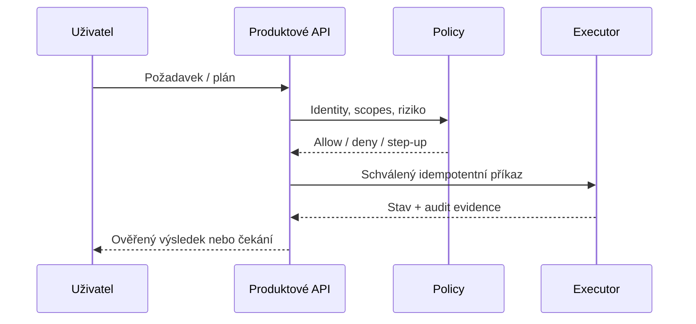

# API a události — ONHOST Reality

**Očekávané integrační body:** ONHOST ID/Wallet za feature flags, Elaris Mate

## Každý API kontrakt dokumentuje

1. Endpoint/method, verzi, stav nasazení, příklad payloadu a response.
2. OIDC scopes, roli, tenant ownership a chybové odpovědi 401/403/409/422/429/5xx.
3. Idempotency key, retry policy, timeout, circuit breaker a compensation.
4. Audit correlation ID, webhook signature, replay protection.
5. Testy pro pozitivní i neoprávněný případ, schema compatibility.

## Propojení agentů

Žádné příklady tohoto dokumentu neimplikují existenci živého endpointu bez route/contract evidence.
