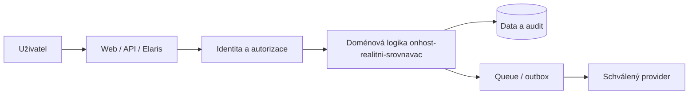

# Systémová architektura — ONHOST Reality

## Zodpovědnost služeb

- Produkt vlastní své doménové entity: Property, Listing, Media, Inquiry, ModerationCase.
- ONHOST ID je systém identity a grantů, nikoli automatické povolení číst všechny údaje.
- ONHOST Core je jediným hosting/billing control plane.
- Elaris Mate volá existující autorizovaná API; jeho chatbot neprovádí přímý SQL nebo shell write.
- Cizí provider je technický executor, nikoli zdroj pravdy o autorizaci.

## Pravidla změny architektury

Každou změnu vlastnictví dat, identity, plateb, runtime či API zdokumentovat formou ADR s alternativami, migrací, negativními testy a rollbackem.
