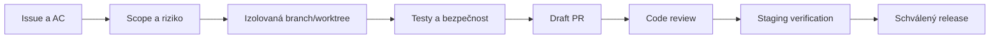

# Týmové workflow

**Produktový vlastník:** Adrian Staněk. Konkrétní tech lead a reviewer jsou určováni u jednotlivých PR; neodhadovat jejich osobní identity.

## Pravidla komunikace

- Handoff obsahuje commit/branch, soubory, test commands + skutečné exit codes, blokery a další krok.
- PR popisuje zákaznickou hodnotu, schema změny, rizika a plán obnovy.
- Schválení identity, financí, zdravotních dat nebo nevratných operací vyžaduje určeného člověka.
- Elaris může tvořit návrhy, testy a PR. Nemůže si sám rozšířit oprávnění.
